# Neuro Assessment Refinement (N5–N9) — REVIEWED 31 Oct

Status: **reviewed, not yet approved to build.** Nothing coded. The original plan is kept unchanged below the line ("Original plan") and as `neuro_assessment_refinement_plan.orig.md`. Code references in the original were checked and are accurate. Scope: `/home/theranet/Clinical-Note` only. Nothing is pushed.

## A. Decisions needed from the owner before building
1. **"Mark visible as Normal / Intact" and ISNCSCI "set all normal down to level X"** — conflict with the earlier rule: never store values that were not measured (Gemini #8). Recommended: presets only **add rows** (+ UL C5–T1, + LL L2–S2, + standard reflexes); no bulk "intact"; for ISNCSCI use "Copy R → L", an "NT" (not tested) value and larger tap targets, or one explicit statement "Screened — no other deficits".
2. **Facial Palsy / Vestibular into the Neuro tab** — conflicts with "Group B modules are Patient-Profile". Cardiothoracic is also omitted by the plan. Recommended: keep all three in the Profile; the Neuro tab shows a one-line link only.
3. **Hosting Gait & Posture in the Neuro tab** — conflicts with "Additional sections stay inline in Core"; Gait is a removable card. Recommended: keep in Core; the mobility block shows a read-only summary (TUG, 10MWT, Tinetti) with a jump link.
4. **MSK Objective auto-collapse** (still open from the 31 Oct review): recommended to collapse only when no MSK region is chosen. The banner wording change depends on this.
5. **Pre-morbid mobility** — History (episode-level) or the Neuro tab? Recommended: History.

## B. Fixes to the plan
- **One home per finding:** Paraplegia/Tetraplegia (condition/ISNCSCI vs strip), MS type (strip Stage vs MS tool), swallowing (strip vs Section 1 chip), neglect (strip vs Stroke flag), falls (strip vs Tinetti/Safety). Autonomic dysreflexia and orthostatic BP are **Safety** red flags (can block sign), not SCI quick chips. Others show a home read-only.
- **Keep the form short:** the context strip has ~30 chips. Show Pattern + Falls; the rest behind "+".
- **New Section 1 symptom chips must do something:** Dizziness → suggest VOMS; Balance/Falls → suggest the mobility block; Tremor → suggest Coordination. Keep behind "+ more" so the MSK default stays short.
- **Missing from the plan:** episode-level carry-forward of context ("Still accurate / Edit"); payload shape (`PAYLOAD_SHAPE_DRAFT.md`); **pinnable re-test measures** (Berg, TUG, 10MWT, FAC, MAS, AIS) so they appear in the daily session note; a meaningful Key Findings line ("R hemiplegia · Berg 38/56 · FAC 3"); specs for neuro medication chips and Section 2/3 safety flags (diagram only today — specify or drop).
- **Clinical:** MAS does not measure rigidity (don't offer MAS rows for cogwheel/lead-pipe); EDSS is neurologist-scored → label "as reported"; Brunnstrom only as an optional quick alternative to Fugl-Meyer; a **clinician must review Area C** (≈40 new clinical fields) before N7.
- Suite count is 34, not 23.

## C. Revised build order
| Step | What | Gate |
|---|---|---|
| N5a | Banner wording + "Open Neuro tab" button; two-sided Coordination; tone muscle-group chips with sides; proprioception row; + UL / + LL buttons that only add rows | none |
| N5b | Neuro treatment chips: add to the Therapeutic Exercise card first, then reorder the quick row when Neuro is on (keep existing chips) | none |
| N6 | Mobility block (bed mobility, transfers, sitting/standing balance, Berg, FAC) + Gait summary line; short context strip (Pattern + Falls visible, rest behind "+") | decisions 3, 5 |
| N7 | Condition-specific additions (Area C) | clinician review |
| N8 | Section 1 symptom chips with defined effects; Safety items | decision 4, one-home fixes |
| N9 | Payload + carry-forward, pinnable measures, Key Findings line, print | — |

Each step: one local commit, one new test, read results before committing.

---

# Original plan (unchanged)

# Plan & Clinical Review: Neuro Assessment Module Refinement (`N5–N9`)

**Context:** Builds directly on top of `CLAUDE_HANDOFF_NEURO_FORM.md` (`N0–N4`, completed 30 Oct) in [clinical-note.html](file:///home/theranet/Clinical-Note/clinical-note.html).  
**Goal:** Make the Neuro Assessment concise, clinically complete, and fast for everyday Neuro Physiotherapists—both when **no condition is selected** (general neuro screen) and when **routine neuro conditions** are selected—while improving the **Core → Neuro → Treatment** bridge with **zero duplicate DOM state**.

---

## 1. Executive Summary of Findings in `clinical-note.html`

> [!IMPORTANT]
> **Key Architectural Principle (Preserved from `N1–N4`):**
> `clinical-note.html` already uses a **single-source-of-truth "One Component, Two Hosts"** pattern (`hostNeuroScreenIn` / `unhostNeuroScreen` at [lines 8150–8172](file:///home/theranet/Clinical-Note/clinical-note.html#L8150-L8172)) and a **build-once slot registry** (`NEURO_TOOLS` at [lines 8108–8132](file:///home/theranet/Clinical-Note/clinical-note.html#L8108-L8132)).  
> Every refinement below **reuses existing DOM cards and calculators** rather than duplicating fields.

### What Works Well Today (`N0–N4`)
1. **Multi-condition slot engine (`syncNeuroForm`):** Selecting multiple conditions (`Stroke / TBI` + `Parkinson's`) reveals the union of tools once, never wipes entered data when switching chips, and allows manual tool addition via `+ Add a tool`.
2. **Shared Basic Neuro Exam (`#card-obj-neuro-screen`):** Dermatomes, Myotomes, and Reflexes move into the `[Neuro]` tab when active and back to Section 4 when closed.
3. **ISNCSCI (ASIA) Smart Swap:** Selecting `Paraplegia / SCI` hides the generic Dermatome/Myotome groups (unless they already contain data) while keeping Reflexes visible.

### The 4 Clinical & UX Gaps to Solve Together (with Claude)
1. **Bridge Friction in Core Sections 1–4:**
   - Section 1 assumes an MSK joint (`Shoulder`, `Knee`) and MSK symptoms (`Pain`, `Stiffness`, `Swelling`), missing primary neuro complaints (`Balance / Falls`, `Gait difficulty`, `Spasticity`, `Tremor / Incoordination`, `Dizziness`, `Facial / Speech / Swallow`).
   - `Facial Palsy` and `Vestibular` sit in `#kc-other` ([lines 1701–1702](file:///home/theranet/Clinical-Note/clinical-note.html#L1701-L1702)) and render at the bottom of the Core tab (`#sec-condition-modules`) instead of inside the `[Neuro]` workspace tab.
   - Section 4's `#msk-collapse-banner` ([line 2486](file:///home/theranet/Clinical-Note/clinical-note.html#L2486)) still says *"Group A (below) covers the neuro-relevant exam"* even though `#sec-group-a` now lives in the top `[Neuro]` tab, and lacks a 1-click **"Open Neuro Tab →"** button.
2. **Condition-less Core Neuro Screen (`NEURO_CORE`) Opens Empty or Incomplete:**
   - If no MSK Region (`Cervical Spine` / `Lumbar Spine`) is picked in Section 1, [`populateDefaults()`](file:///home/theranet/Clinical-Note/clinical-note.html#L7474-L7488) returns early (`if(!groupKey) return;`), leaving Dermatomes, Myotomes, and Reflexes **completely blank** when a therapist opens `[Neuro]` directly.
   - `tone_spasticity` ([lines 7702–7722](file:///home/theranet/Clinical-Note/clinical-note.html#L7702-L7722)) forces typing muscle names into a blank text box and lacks global tone descriptors (`Normal`, `Spastic`, `Rigidity: Cogwheel / Lead-pipe`, `Hypotonic / Flaccid`).
   - `coordination_cerebellar` ([lines 7751–7758](file:///home/theranet/Clinical-Note/clinical-note.html#L7751-L7758)) has `Normal | Impaired | Unable` with **no `L / R` laterality**.
   - **Proprioception (Joint Position Sense)** is missing from `basic_exam`.
3. **Missing Neuro Context, Transfers/Balance & Hosted Gait:**
   - There is no top-of-form **Neuro Context Strip** (Topography: *R/L Hemiplegia, Para/Tetraplegia, Diplegia, Ataxic*; Stage; Pre-morbid vs. Current Mobility; Orthosis/AFO; Fall history).
   - **Bed Mobility, Transfers & Sitting/Standing Balance** are missing, while **Gait & Posture** (`#tier2-gait` with Gait chips, Assistive Device, TUG, 10MWT, and Tinetti POMA `/28` at [lines 7322–7381](file:///home/theranet/Clinical-Note/clinical-note.html#L7322-L7381)) already exists as an inline Tier 2 card and can be **hosted** or linked directly inside the `[Neuro]` tab!
4. **Section 6 (`Intervention / Therapy`) Quick Chips Are 100% MSK:**
   - `QUICK_TX` (`#lean-quick-tx` at [lines 13568–13573](file:///home/theranet/Clinical-Note/clinical-note.html#L13568-L13573)) shows `Joint mobilisation`, `Dry needling`, `Ultrasound`, `Taping/KT`, missing core Neuro Physiotherapy interventions (`Gait training`, `Transfer & Bed mobility`, `Balance / Postural control`, `Task-specific training`, `Tone / Spasticity mgmt`, `FES / NMES`, `Cueing / Dual-task`, `Vestibular / Epley`).

---

## 2. Target Architecture: Core Bridge & `[Neuro]` Section Flow

```mermaid
flowchart TB
    subgraph CORE_INTAKE["Core Assessment Tab (Sections 1–4)"]
        S1["1. Chief Complaint<br/>• Known Condition → Neuro / systemic (now includes Facial Palsy & Vestibular)<br/>• Primary Symptoms adds Neuro chips when Neuro active<br/>• Pain Profile stays gated behind 'Pain'"]
        S23["2. History & 3. Safety<br/>• Neuro med chips (Baclofen, Levodopa, Anticoagulants, Anti-epileptics)<br/>• Neuro safety flags (Falls, Orthostatic BP, Autonomic Dysreflexia, Swallow)"]
        S4["4. Objective (#msk-collapse-banner)<br/>MSK Objective auto-collapses when Neuro condition active.<br/>Banner includes 1-click button: [ Open Neuro Exam Tab → ]"]
        S1 --> S23 --> S4
    end

    subgraph NEURO_TAB["[Neuro] Workspace Tab (#sec-group-a)"]
        N1["Block 1: Condition Bar + Neuro Context Snapshot (core)<br/>• Conditions (#ga-cond-chips)<br/>• Pattern (R/L Hemi, Para, Tetra, Bilateral, Ataxic, Cranial)<br/>• Pre-morbid vs Current Mobility, Orthosis (AFO/Sling), Fall Risk"]
        N2["Block 2: Core Neuro Bedside Screen (core — always shown)<br/>• Basic Neuro Exam (#card-obj-neuro-screen hosted): Dermatomes, Myotomes, Reflexes + Proprioception + 1-click UL/LL Presets & 'All Intact'<br/>• Tone & Spasticity: Tone type + Muscle-group chip picker + MAS (0–4) + Clonus<br/>• Coordination / Cerebellar: L/R bilateral grading"]
        N3["Block 3: Condition-Specific Expansion Slots (auto-fired by condition)<br/>• Stroke/TBI: Motor UMN (+ Shoulder subluxation / Brunnstrom / Neglect) + Fugl-Meyer + Cognitive<br/>• SCI: ISNCSCI Worksheet (+ Fast-fill normal helper)<br/>• Parkinson's: Hoehn & Yahr (+ ON/OFF state, Freezing, Tremor, Cueing)<br/>• MS: Fatigue/Relapse (+ Subtype & Heat sensitivity)<br/>• Peripheral Neuropathy: Bilateral Monofilament/Vibration + Foot/Ulcer check<br/>• Concussion: Symptom checklist + RTA stage + Cognitive<br/>• Facial Palsy: Hosted #card-facial-palsy (House-Brackmann, Eye care, Sunnybrook)<br/>• Vestibular: Hosted #card-vestibular (Dix-Hallpike, HIT, Nystagmus, Romberg, DGI, DHI)"]
        N4["Block 4: Functional Mobility, Balance & Gait (core — always shown)<br/>• Bed Mobility & Transfers (Rolling, Supine→Sit, Sit→Stand, Bed↔Chair: Indep → Dependent)<br/>• Sitting & Standing Balance (Static / Dynamic)<br/>• Hosted #tier2-gait (Gait pattern chips, Assistive device, TUG, 10MWT, Tinetti /28) + Berg (/56)<br/>• Footer Button: [ Continue to 5. Clinical Impression → ]"]
        N1 --> N2 --> N3 --> N4
    end

    subgraph CORE_WRAP["Core Assessment Tab (Sections 5–7)"]
        S5["5. Clinical Impression<br/>Read-only Neuro Summary Pill in #ci-cross-refs"]
        S6["6. Intervention / Therapy<br/>Context-aware Neuro Quick Chips in #lean-quick-tx"]
        S7["7. Plan & Goals"]
        S5 --> S6 --> S7
    end

    S4 == "Switches to 'groupa' tab" ==> N1
    N4 == "Switches to 'core' tab & scrolls to #sec-clinical-impression" ==> S5
```



---

## 3. Detailed Specification by Area (For Review with Claude)

### Area A: Core-to-Neuro Bridge Improvements (Sections 1, 4, 5, 6)

1. **Unify `Facial Palsy` and `Vestibular` into `#kc-neuro` & `#ga-cond-chips`:**
   - Currently `Facial Palsy` and `Vestibular` live in `#kc-other` ([lines 1701–1702](file:///home/theranet/Clinical-Note/clinical-note.html#L1701-L1702)).
   - **Option for Review:** Move (or alias) `Facial Palsy` and `Vestibular` into `#kc-neuro` and `#ga-cond-chips` so they open inside the `[Neuro]` tab as `NEURO_SPECIAL` hosted slots (`hostFacialPalsyIn`, `hostVestibularIn`) reusing `#card-facial-palsy` and `#card-vestibular` without rebuilding them.
2. **Primary Symptoms (`#primary-complaint` in Section 1):**
   - Add neuro-relevant symptom chips (`Balance / Falls`, `Gait difficulty`, `Spasticity / Tightness`, `Dizziness / Vertigo`, `Tremor / Incoordination`, `Fatigue`, `Facial / Speech / Swallow`)—either always visible or revealed when `#kc-neuro` / `[Neuro]` is active.
3. **Section 4 `#msk-collapse-banner` ([lines 2483–2489](file:///home/theranet/Clinical-Note/clinical-note.html#L2483-L2489)):**
   - Update the stale copy (*"Group A (below) covers the neuro-relevant exam"*) to reference the **`[Neuro]`** tab and add a button:
     ```html
     <button type="button" class="chip" id="msk-open-neuro-tab">Open Neuro Assessment Tab →</button>
     ```
     which calls `window.openNeuroModule({switch: true})`.

---

### Area B: Fixing the Core Neuro Assessment When *No* Condition Is Selected

When a therapist opens `[Neuro]` with **no condition chip selected** (or before choosing one), the core blocks should be immediately usable in under 60 seconds:

#### 1. New Core Slot 0: `neuro_context` ("Neuro Presentation & Baseline")
Placed at the very top of `#group-a-body` (`core: true`):
- **Distribution / Pattern:** `Right Hemiplegia` · `Left Hemiplegia` · `Paraplegia` · `Tetraplegia` · `Diplegia` · `Monoplegia` · `Bilateral / Extrapyramidal` · `Ataxic / Cerebellar` · `Cranial / Bulbar`
- **Stage:** `Acute` · `Subacute` · `Chronic` · `Relapsing-Remitting` · `Progressive`
- **Communication / Perceptual Flags (optional chips):** `Intact` · `Expressive Aphasia` · `Receptive Aphasia` · `Dysarthria` · `Dysphagia` · `Hemispatial Neglect` · `Visual Field Deficit`
- **Pre-morbid vs. Current Mobility & Fall History:**
  - *Pre-morbid:* `Independent` · `With Walking Aid` · `Wheelchair / Dependent`
  - *Orthosis / Splint:* `None` · `AFO` · `KAFO` · `Wrist/Hand Splint` · `Shoulder Sling`
  - *Falls (Last 6 mos):* `None` · `Near-falls` · `1–2 falls` · `Recurrent (≥3 falls)`

#### 2. `basic_exam` (`#card-obj-neuro-screen` Hosted Slot) Improvements
- **Solve the "Empty on Open" Bug:** When `#card-obj-neuro-screen` is hosted inside `#sec-group-a` and no MSK Region is set, display a compact **Preset Bar** at the top of `#obj-neuro-screen-body`:
  - **`+ Upper Limb (C5–T1)`** · **`+ Lower Limb (L2–S2)`** · **`+ All Standard Reflexes`** · **`✓ Mark Visible as Normal / Intact`**
- **Add Deep Sensation (Proprioception):** Add a single bilateral row under Dermatomes:
  - `Proprioception / Joint Position Sense` (`Intact | Impaired | Absent` — `L` and `R`).

#### 3. `tone_spasticity` Slot Improvements ([lines 7702–7722](file:///home/theranet/Clinical-Note/clinical-note.html#L7702-L7722))
- Add a **Global Tone Pattern** chip row above the MAS rows:
  - `Normal` · `Hypertonic (Spastic)` · `Rigidity (Cogwheel)` · `Rigidity (Lead-pipe)` · `Hypotonic / Flaccid` · `Mixed`
- Replace the blank text input (`placeholder="e.g. R elbow flexors"`) with **1-tap muscle group chips** (`Shoulder IR/Add`, `Elbow Flexors`, `Elbow Extensors`, `Wrist/Finger Flexors`, `Hip Adductors`, `Knee Extensors`, `Hamstrings`, `Ankle Plantarflexors` + `Custom`) that add a bilateral (`L / R`) or side-tagged MAS (`0, 1, 1+, 2, 3, 4`) row in 1 click.

#### 4. `coordination_cerebellar` Slot Improvements ([lines 7751–7758](file:///home/theranet/Clinical-Note/clinical-note.html#L7751-L7758))
- Switch `Finger-to-nose`, `Heel-to-shin`, and `Rapid alternating movements` from unilateral `makeGroupAGradeRow` to bilateral `makeGroupABilateralRow(label, ['Normal', 'Impaired', 'Unable'])` so `L` and `R` can be graded independently.

#### 5. New Core Slot: `functional_mobility` ("Functional Mobility, Balance & Gait")
Placed at the bottom of the Core Neuro slots (`core: true`):
- **Bed Mobility & Transfers** (`Indep | Supervision | Min A | Mod A | Max A | Dependent`):
  - `Rolling` · `Supine ↔ Sit` · `Sit ↔ Stand` · `Bed ↔ Chair / Wheelchair Transfer`
- **Postural Control & Balance** (`Normal | Good | Fair | Poor | Unable`):
  - `Sitting Balance (Static / Dynamic)` · `Standing Balance (Static / Dynamic)`
- **Gait & Standardised Balance/Gait Outcomes:**
  - **Host `#tier2-gait`** (`Gait & Posture` from [lines 7331–7381](file:///home/theranet/Clinical-Note/clinical-note.html#L7331-L7381), which already has Gait chips, Assistive Device, Dependency, TUG, 10MWT, and Tinetti POMA `/28`!) using the exact same `hostIn` / `unhost` pattern as `#card-obj-neuro-screen`, and add a 1-line numeric input for **Berg Balance Scale (`/56`)** and **Functional Ambulation Category (`FAC 0–5`)**.

---

### Area C: Condition-Specific Module Refinements (`NEURO_TOOLS`)

| Condition | Existing Tool(s) | Targeted Clinical Refinements |
| :--- | :--- | :--- |
| **Stroke / TBI** | `motor_umn`, `fugl_meyer`, `cognitive_screen_light` | In `motor_umn`, add: <br/>1. **Hemiplegic Shoulder Check:** `GH Subluxation (Absent / <1 FB / 1–2 FB / >2 FB)` + `Shoulder Pain (Yes/No)`<br/>2. **Brunnstrom Stage (Optional 1–6 quick stage)** for UE / Hand / LE when full FMA isn't scored<br/>3. **Pusher Syndrome / Neglect flag** |
| **Paraplegia / SCI** | `isncsci` | In `isncsci`, add:<br/>1. **Quick-Fill Normal Helper:** `"Set all levels normal (2/5) down to: [Level dropdown] [Apply]"` to avoid 100+ manual clicks for lower thoracic/lumbar injuries.<br/>2. **Autonomic / Skin / Bladder Quick Chips:** `Autonomic dysreflexia risk`, `Orthostatic hypotension`, `Pressure area check`, `Bladder/Bowel status`. |
| **Parkinson's** | `hoehn_yahr` | Expand `hoehn_yahr` slot with a compact **PD Motor & Cueing block**:<br/>1. **Exam Medication State:** `ON` · `OFF` · `Wearing off` · `Dyskinetic`<br/>2. **Cardinal Signs:** `Resting tremor` · `Bradykinesia` · `Freezing of Gait (Start / Turn / Doorway / Dual-task)` · `Postural instability / Retropulsion`<br/>3. **Effective Cues:** `Visual cues` · `Auditory/Rhythmic cues` · `Big amplitude strategy` |
| **MS** | `fatigue_relapse_ms` | Add **MS Subtype** (`RRMS` · `SPMS` · `PPMS`), **Uhthoff's / Heat sensitivity** (`Yes / No`), and optional **EDSS score (`0–10`)**. |
| **Peripheral Neuropathy** | `sensory_peripheral` | Make `Monofilament` and `Vibration sense` **bilateral (`L / R`)**, add **Neuropathic symptom chips** (`Burning`, `Tingling`, `Allodynia`, `Foot drop`), and **Diabetic / Trophic Foot Screen** (`Skin intact` · `Callus/Redness` · `Ulcer risk`). |
| **Concussion** | `symptom_checklist_concussion`, `cognitive_screen_light` | Add a 1-click bridge chip **`+ Open VOMS / Vestibular Screen`** when `Dizziness` or `Balance problems` is checked. |
| **Facial Palsy** *(New in Neuro Bar)* | Hosts `#card-facial-palsy` | Reuses existing House-Brackmann (`I–VI`), Eye Care / Lagophthalmos red flag, and Sunnybrook (`/100`) card inside a Neuro slot. |
| **Vestibular** *(New in Neuro Bar)* | Hosts `#card-vestibular` | Reuses existing Dix-Hallpike, Canal, HIT, Nystagmus, Romberg, DGI (`/24`), and DHI (`/48`) card inside a Neuro slot. |

---

### Area D: Neuro-Aware Treatment Section (`6. Intervention / Therapy`)

1. **Expand `#body-therapeutic-exercise` ([lines 3369–3375](file:///home/theranet/Clinical-Note/clinical-note.html#L3369-L3375)):**
   - Under `Motor control / neuromuscular` (or a new `Neurorehabilitation & Functional` sub-row), add:
     - `Gait training` · `Transfer & bed mobility training` · `Task-specific / ADL training` · `Tone / spasticity management` · `Cueing & dual-task training` · `Mirror therapy / CIMT` · `Vestibular rehabilitation (Canalith / VOR)` · `Facial neuromuscular re-education`
2. **Dynamic Neuro Quick-Chips in `#lean-quick-tx` ([lines 13568–13591](file:///home/theranet/Clinical-Note/clinical-note.html#L13568-L13591)):**
   - When `window.__neuroModuleOn()` is `true`, surface Neuro quick-treatment chips in `#lean-quick-tx` (`Gait training`, `Transfer & bed mobility training`, `Proprioception/balance training`, `Neuromuscular re-education`, `Task-specific / ADL training`, `Tone / spasticity management`, `PNF`, `NMES`, `Stretching`, `ROM exercises`) while keeping any already-selected MSK chips visible so nothing is ever lost.

---

## 4. Suggested Phased Build Order (`N5–N9`)

| Step | Scope | Key Deliverable | Verification |
| :--- | :--- | :--- | :--- |
| **N5** | **Core Neuro Usability (No-Condition Mode)** | Preset bar (`+ UL C5–T1`, `+ LL L2–S2`, `✓ All Intact`) + Proprioception in `basic_exam`; Global tone chips + muscle-group chip picker in `tone_spasticity`; Bilateral `L/R` in `coordination_cerebellar`. | `neuro-form.mjs` + existing 23 suites |
| **N6** | **Neuro Context Strip & Functional Mobility / Hosted Gait** | `neuro_context` slot (Pattern, Stage, Mobility/Orthosis, Falls) + `functional_mobility` slot (Bed mobility, Transfers, Sitting/Standing Balance + hosted `#tier2-gait` + Berg `/56`). | New assertions in `neuro-form.mjs` |
| **N7** | **Unify Facial Palsy & Vestibular + Condition Slot Upgrades** | Host `#card-facial-palsy` & `#card-vestibular` in Neuro slots; add Stroke shoulder/Brunnstrom, SCI fast-fill normal helper, PD ON/OFF & freezing/cueing, MS heat flag, bilateral Peripheral Neuropathy. | `neuro-form.mjs` + `step3.mjs` |
| **N8** | **Core ↔ Neuro Bridge & Neuro-Aware Treatment (`Section 6`)** | Section 1 neuro symptom chips, Section 4 `[Open Neuro Tab →]` button, bottom `[Continue to 5. Impression →]` button, and Neuro quick-chips in `#lean-quick-tx`. | `core-layout-step1.mjs` + `neuro-form.mjs` |
| **N9** | **Print, Payload & Summary Line Polish** | Ensure `neuroSummaryLine()` and Print/PDF preview format the new context, functional mobility, and hosted cards cleanly. | `preview.mjs` + `print-pdf.mjs` |

---

## 5. Open Questions for Review with Claude

1. **Hosting `#tier2-gait` vs. Dedicated Neuro Gait Row:** Should the `[Neuro]` tab host the existing `#tier2-gait` component (same "one component, two hosts" pattern as `#card-obj-neuro-screen`), or keep `#tier2-gait` in Core and only put Bed Mobility / Transfers / Balance inside `[Neuro]`? *(Recommendation: Host `#tier2-gait` inside `functional_mobility` when Neuro is active so Gait, TUG, 10MWT, and Tinetti `/28` sit right below Transfers & Balance with zero duplication.)*
2. **Hosting `#card-facial-palsy` and `#card-vestibular`:** Should `Facial Palsy` and `Vestibular` move into `#kc-neuro` / `#ga-cond-chips` as part of the unified Neuro Assessment tab, or remain separate `#kc-other` cards? *(Recommendation: Move/host them into the Neuro tab's condition bar and `+ Add a tool` menu so all neurological exams live in one place.)*
3. **ISNCSCI Fast-Fill Helper:** In `buildIsncsciWorksheet()`, does a `"Set levels normal (2/5) down to [Level]"` toolbar button satisfy the "no pre-filled clinical values without clinician action" rule? *(Yes—because nothing is pre-filled until the clinician explicitly picks the intact boundary level and clicks Apply.)*
